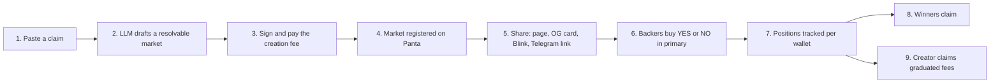
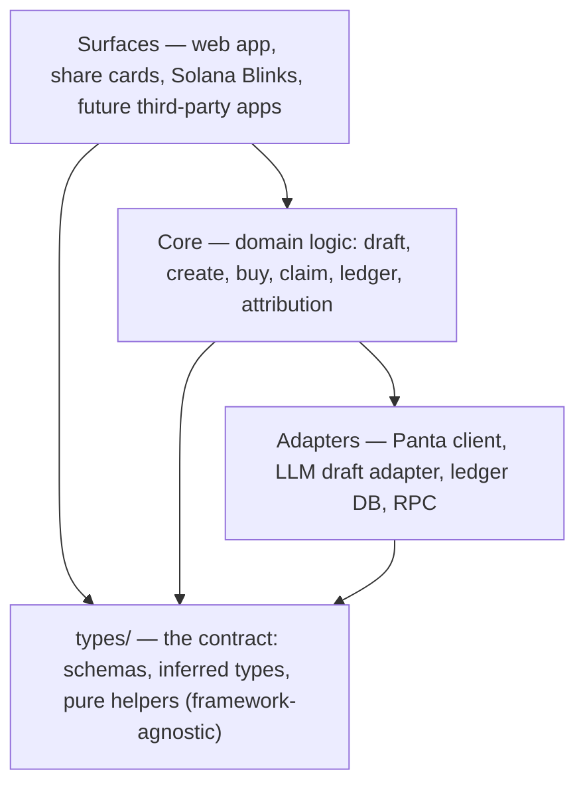
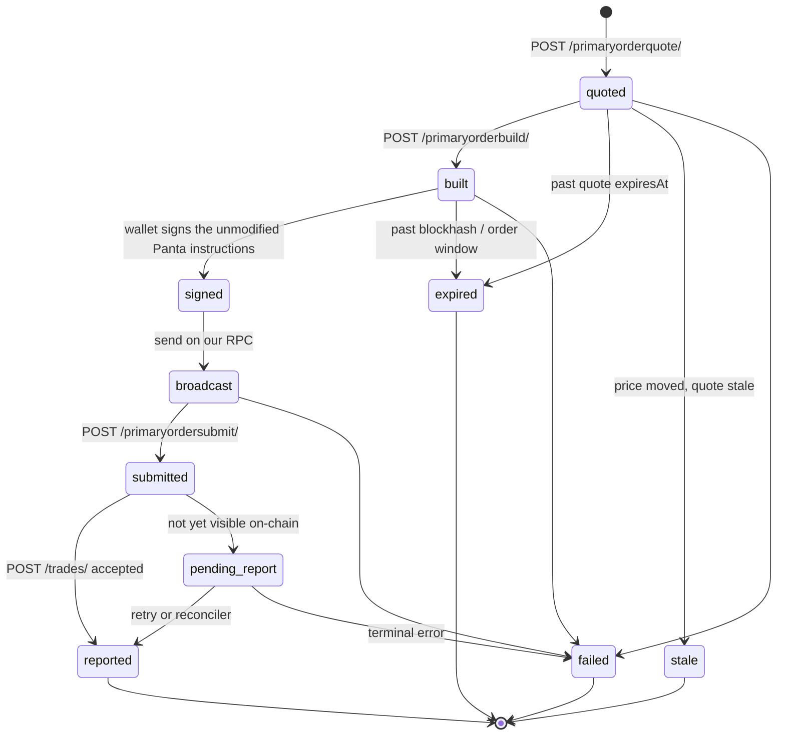

<div align="center">

# Callit

**Prediction markets, right where you already are.**

Turn a claim or a hot take into a real, tradable YES/NO market in about a minute — then share it as a link, a card, or an in-feed Solana Blink so people can back it right where they already are.


`Live demo: TBD` · `Demo video: TBD` · `Powered by Panta`

</div>

> **Project status.** This repository is an early hackathon build on top of a fresh Next.js scaffold. The **type contracts in `types/` are implemented** (schemas, inferred types and pure helpers); the application surfaces (create, share, trade, claim) are **planned**. The **Status** column in [Panta integration](#how-callit-integrates-the-panta-api) and the [Roadmap](#roadmap) are the source of truth for what actually exists. Nothing is described as live unless it is live. All Panta facts are either drawn from the official Panta API documentation or explicitly tagged **UNVERIFIED**.

---

## What it is

Callit turns a claim or hot take into a real, tradable prediction market in about a minute, then lets you share it as a link, a card, or an in-feed Solana Blink so people can back YES or NO right where they already are. Prediction markets already exist, but they live on their own sites and ask people to come to them — the communities and creators who actually have an audience get nothing from that. Callit embeds the market inside the places an audience already is (a post, a group chat, a channel) and attributes every trade back to the surface it came from.

Technically: **a non-custodial distribution layer for Panta prediction markets — AI-drafted, resolvable markets with create, buy and claim flows, exposed as Solana Actions (Blinks) and share cards, with per-channel attributed-volume tracking.**

## Who it's for

There is **one identity: a Solana wallet.** Any wallet can create a market, back YES or NO, and claim.

Roles are **not** user types. They are relationships derived per market from data:

- `created-by` — this wallet created the market
- `holds-side` — this wallet holds YES or NO shares
- `can-claim-win` — a winning position is claimable
- `can-claim-creator-fees` — this wallet created a graduated market with fees to claim

"My activity" is a single derived view over that data: markets this wallet created, positions it holds, and claims it can make. It is built for communities and creators who have an audience — but it is open to anyone with a wallet.

## Demo

> Placeholders — fill these in before submission. Do not present fixtures as live data.

- **Live app:** `TBD`
- **Demo video:** `TBD`

**Screenshots to capture**

1. The create screen: a pasted claim with the AI-drafted market and the creation fee shown before signing.
2. The sign/pay step, including the fee disclosure.
3. The hosted market page with the live odds, an "as of" timestamp, and the **Powered by Panta** badge.
4. The share card (Open Graph image) as it renders.
5. The market rendered as a Solana Blink in a wallet client.
6. A completed YES/NO buy with the `feeUsdc` shown before signing.
7. "My activity": created markets, positions held, claims available.
8. The public stats page: attributed volume by source, distinct wallets, test vs user volume.

## How it works



1. **Create.** A user pastes a claim. An LLM drafts a schema-valid market that is *resolvable* — one public, dated, unambiguous source. The app shows the creation fee. The user signs and pays, then the market is registered with Panta.
2. **Share.** A hosted market page, an Open Graph / Twitter share card (odds plus a badge), and a Solana Blink (Solana Actions `GET` metadata and `POST` with a chained callback). **X in-feed rendering requires the domain to be approved in Dialect's registry.** **Telegram shows a normal link preview only** — not a bot and not an in-chat widget.
3. **Trade.** A YES/NO primary buy, with the fee shown before signing.
4. **Track and claim.** Positions, win claims, and creator-fee claims (graduated markets only).
5. **Attribute.** A per-channel ledger reported to Panta, with a public stats page cross-checked against Panta's account metrics.

### Blinks and share cards

A **Solana Blink** is a set of Solana Actions: a `GET` returns the market metadata (title, description, an icon, and `Powered by Panta`), and a `POST` with `{ "account": "<wallet>" }` returns an unsigned transaction the wallet can sign, plus a `links.next` callback. The callback posts `{ "account", "signature" }` back to us so we can report the trade. Callit never adds instructions or accounts to Panta's transactions (see [Reliability and safety](#reliability-and-safety)).

A **share card** is a server-rendered Open Graph image (via `@vercel/og`) carrying the current odds, the market title, and the **Powered by Panta** badge. Every odds value carries an "as of" timestamp.

## How Callit integrates the Panta API

Base URL: `https://live-api.panta.market/api/v1`. Auth is the `X-Api-Key` header, **server-side only**. All endpoints require a trailing slash. Panta returns **unsigned transactions or instructions**; the user's wallet signs, we broadcast on our own RPC, and we report the signature back. There is **no testnet** — `pk_test_` and `pk_live_` both hit production, so every signature moves real USDC.

The `types/` contracts for every row below exist now; the runtime code (`lib/panta/`, the app surfaces) is **planned**. Status is `Types defined` when the contract exists in `types/` and `Planned` otherwise — nothing here is marked **Live**.

| Panta endpoint | What Callit uses it for | Where in the codebase | Status |
| --- | --- | --- | --- |
| `GET /categories/` | Populate the category picker when drafting a market | `types/panta-wire/markets.ts`; `lib/panta/` (planned) | Types defined |
| `GET /markets/` (`category`, `status`, `createdBy=me`, `cursor`, `limit`) | Browse markets and list markets created by a wallet | `types/panta-wire/markets.ts` | Types defined |
| `GET /markets/{id}/` | Market detail page (prices filled in here) | `types/panta-wire/markets.ts` | Types defined |
| `POST /markets/create/image-upload/` | Signed Cloudinary upload so the market image ends up as a public `http(s)` URL | `types/panta-wire/create.ts` | Types defined |
| `POST /markets/create/quote/` | Creation fee + expected event PDA; the quote is the **only** authority on the fee | `types/panta-wire/create.ts` | Types defined |
| `POST /markets/create/build/` | Base64 versioned transaction for the creator to sign and pay | `types/panta-wire/create.ts` | Types defined |
| `POST /markets/register/` | Register the market after the signature | `types/panta-wire/create.ts` | Types defined |
| `POST /primaryorderquote/` | Primary buy quote: shares, average price, `feeUsdc`, `expiresAt` | `types/panta-wire/buy.ts` | Types defined |
| `POST /primaryorderbuild/` | Build the buy: raw instructions, recent blockhash, expiry | `types/panta-wire/buy.ts` | Types defined |
| `POST /primaryordersubmit/` | Report the broadcast signature to Panta | `types/panta-wire/buy.ts` | Types defined |
| `POST /primaryorderverify/` | Verify order status; returns `amountUsdc` in **base units** | `types/panta-wire/buy.ts` | Types defined |
| `POST /trades/` | Report buy and claim signatures for attribution and volume; idempotent per signature | `types/panta-wire/trades.ts`, `types/ledger.ts` | Types defined |
| `GET /positions/?wallet=` | Positions for "My activity" and claim eligibility | `types/panta-wire/positions.ts` | Types defined |
| `POST /claim/build/` | Build the winning-shares claim transaction | `types/panta-wire/claim.ts` | Types defined |
| `POST /claim/creator-fees/build/` | Build the creator-fee claim (graduated markets only) | `types/panta-wire/claim.ts` | Types defined |
| `GET /account/metrics/?limit=` | Account-level attributed totals to cross-check our public stats page | `types/panta-wire/metrics.ts` (shape **UNVERIFIED**) | Types defined |
| `userId` on quote/build (and `X-User-Id` header) | Tag every order with its originating app/surface so volume can be attributed | `types/attribution.ts`, `types/app-registry.ts` | Types defined |

**Status legend:** **Live** = implemented and running · **Types defined** = the contract exists in `types/` · **Planned** = not yet built. The `types/` modules have landed; a row's application surface flips to *Live* only as it ships.

**Error handling.** Panta errors are `{ code, message, fields? }` plus an HTTP status. Codes seen so far include `QUOTE_EXPIRED`, `QUOTE_STALE`, `CREATE_EXPIRED`, `DUPLICATE_MARKET`, `TX_NOT_FOUND`, `TX_MISMATCH`, and field-level validation errors; HTTP `429` carries `Retry-After`. **The full list of codes is unknown**, so the type-level union ends in a typed `UNKNOWN` fallback that preserves the raw code.

## Architecture overview and the type system



**Layering.** `types/` is the contract every other layer builds against. It is **framework-agnostic**, has **no server-only imports**, and is safe for the UI, server code, and future third-party apps to import. `core/` holds domain logic. `adapters/` holds the Panta client, the LLM draft adapter, the ledger DB, and RPC. `surfaces/` are the web app, share cards, Blinks, and future apps. *(Core, adapters and surfaces are planned; `types/` is implemented.)*

### Branded money and identifiers

Money and units are branded so they can never be mixed:

- **`UsdcDecimal`** — a USDC amount as a decimal string, at most 6 decimals
- **`UsdcBaseUnits`** — a USDC amount as an integer `bigint` in base units (6 decimals)
- **`Shares`** — a share count as a decimal string
- **`Price`** — a price as a decimal string

Explicitly named pure converters go one way and back, with a single documented rounding rule. **No floating-point arithmetic on money, ever.** The verify endpoint's `amountUsdc` (a **number in base units**, unlike the decimal strings returned by quote and build) gets its own parser that rejects unsafe integers.

Identifiers are branded too: `WalletAddress` (a validated Solana public key), `TxSignature`, `MarketId`, `OrderId`, `QuoteId`, `CreateId`, `EventPda`, plus `IdempotencyKey`, `UserIdTag`, and `CampaignTag`. `WalletAddress` is validated in `types/` with a pure base58/length check — **no `@solana/web3.js` import in `types/`**, so the contract stays dependency-light and isomorphic.

### State machines

Illegal states are unrepresentable: the lifecycles are discriminated unions where each state carries only the data valid at that point.

- **Market phase:** `primary | secondary | resolved | cancelled`, with a type-level guard that **buying is only valid in `primary`** and an explicit "link out" case for `secondary`.
- **Buy lifecycle:** `quoted → built → signed → broadcast → submitted → reported`, plus `expired`, `stale`, and `failed` branches. A quote has an `expiresAt` and no signature; only later states carry one.
- **Create lifecycle:** `drafted → validated → resolvable → imaged → quoted → built → signed → registered`, plus `CREATE_EXPIRED` and `DUPLICATE_MARKET` branches.
- **Ledger row status:** `built | submitted | reported | pending_report | failed`, with a map of legal transitions and a pure `canTransition` helper.



### The draft pipeline

LLM output is treated as **hostile input** and moves through stages that can only be entered through validator functions:

- **`RawDraft`** — untrusted LLM output, including prompt-injection flags
- **`ValidatedDraft`** — passes the Panta field constraints (lengths, non-empty sources, ordered timestamps, a valid category)
- **`ResolvableDraft`** — passes the resolvability check (one public, dated, unambiguous source; standard markets start at least ~3,700 seconds out)

A typed **`ResolvabilityReport`** carries reasons and suggestions so the UI can explain a rejection.

### Compliance as types

Where possible, obligations are enforced by construction: a **`PANTA_BADGE`** constant equal to the exact string `Powered by Panta`; a **`DisplayPrice`** that cannot be built without an accompanying **`AsOf`** timestamp; a **`FeeDisclosure`** that must be present before a signing step; and a **`DataProvenance`** tag (`live | cached | fixture`) so fixture data can never silently pass as live. These force construction order; **they cannot force a screen to render the badge** — that remains a review obligation, and the README says so rather than pretending otherwise.

### Extensibility

Core domain types mention no specific app or surface. Apps, surfaces and operations come from **registry-driven unions** (`APP_REGISTRY`, `SURFACES`) — adding an app or surface is a config change, not a type rewrite. The Panta wire schemas live in their own module so an API change touches one place. Public API types carry an **`ApiVersion`** brand with versioned response envelopes and a stable third-party error envelope (machine-readable code, human message, `retryable` flag). **Per-app rate budgeting and a "budget exhausted" outcome are designed for but not implemented.**

## Reliability and safety

**Timing windows.** Every Panta step is short-lived:

| Step | Validity | Notes |
| --- | --- | --- |
| Primary buy quote (`/primaryorderquote/`) | ~90s | Re-quote if expired |
| Primary buy build (`/primaryorderbuild/`) | ~120s | Blockhash valid ~60s — rebuild if stale |
| Create session (`/markets/create/quote/`) | ~5 min | The quote is the only authority on the creation fee |
| Create build (`/markets/create/build/`) | Blockhash ~60s | Rebuild if stale |

**Re-quote behavior.** A quote that has passed `expiresAt` is re-quoted; a build whose blockhash has fallen out of its window is rebuilt. The UI never signs a stale artifact.

**Report retry and the reconciler.** `POST /trades/` returns `TX_NOT_FOUND` until Panta can see the transaction on-chain, so Callit reports **only after confirmation** and retries with backoff. Because Blink chaining (`links.next` then a callback `POST` of `{account, signature}`) is **not guaranteed to fire in every client**, a reconciler finds the signature on-chain and reports it out-of-band. *(Reconciler is planned.)*

**Idempotency.** `POST /trades/` is idempotent per signature. Build, submit and report operations require an `IdempotencyKey`.

**Rate limits and caching.** Panta enforces per-account limits per 60 seconds, shared across one key:

| Budget | Per 60s |
| --- | --- |
| Reads | 120 |
| Positions | 60 |
| Quotes | 30 |
| Builds | 20 |

Callit caches reads with an explicit TTL and **never serves stale data as write permission**. Serverless caveat: in-memory caches are **not shared across Vercel instances**, so caching uses a shared store (or the DB) and every cached price carries its own "as of" time. *(Cache layer is planned.)*

**Fail-closed rule (hard).** Panta's transaction verification is fail-closed, and **we must never add instructions or accounts to Panta's transactions**. `types/` encodes a branded, opaque `PantaTransaction` that downstream code treats as unmodifiable, and a documented signer-check type flags the risk of any signer other than the user's wallet. On any unhandled error, the default path is deny/no-op.

## Compliance and responsible use

- The exact wording **`Powered by Panta`** appears near Panta-powered functionality on every surface: web, share card, Blink title/description/icon, embeds, and Telegram share text.
- **No wash trading and no artificial volume.** Test volume and user volume are tracked separately, and the stats page shows both.
- **Cached and demo data is never presented as live.** Every price shown to a user carries an "as of" timestamp, and fixture data is labeled as fixture.
- **Fees are shown before signing** — both the creation fee and the per-buy `feeUsdc`.
- **No open proxy.** Only specific, allowlisted operations are reachable; the Panta API key never reaches the browser.
- **`Panta` is not in the product name** (the Terms prohibit confusing users about who operates the product).
- **Age and jurisdiction notices** are shown. **This is not legal advice.**

## Traction

Numbers are **TBD** and are only ever filled in from real data. They are cross-checked two ways: our own per-channel ledger, and Panta's `GET /account/metrics/` attributed totals.

| Metric | Value | How it is verified |
| --- | --- | --- |
| Attributed volume (USDC) | TBD | Our ledger, reconciled against `/account/metrics/` |
| Distinct wallets | TBD | Distinct `WalletAddress` in the ledger |
| Volume by source (app/surface) | TBD | Ledger `source` / attribution field |
| Test volume | TBD | Ledger rows tagged `volumeClass: test` |
| User volume | TBD | Ledger rows tagged `volumeClass: user` |

> Unreported buys do not count toward Panta's attributed volume, and Panta's indexer can lag. Our reconciler is the tie-breaker.

## Setup

**Prerequisites:** Node.js and **pnpm** (the repo pins `pnpm@11.1.2`). No testnet — this targets Solana **mainnet**.

**Environment variable names** (names only — never commit values):

| Variable | Scope | Purpose |
| --- | --- | --- |
| `PANTA_API_KEY` | server-only | `X-Api-Key` for the Panta API |
| `PANTA_API_BASE_URL` | server-only | Panta base URL (default `https://live-api.panta.market/api/v1`) |
| `SOLANA_RPC_URL` | server-only | Our RPC for broadcasting signed transactions |
| `DATABASE_URL` | server-only | Hosted ledger DB |
| `LLM_API_KEY` | server-only | Market drafting |
| `NEXT_PUBLIC_APP_URL` | public (`NEXT_PUBLIC_`) | Base URL used in share cards and Blinks |

> The env schema lives in `types/env.ts`, split into `NEXT_PUBLIC_` (public) and server-only keys. Server-only values are never imported by client modules; that boundary is enforced by convention plus a lint rule in the app layer, because TypeScript cannot enforce it.

**Commands that exist today:**

```bash
pnpm install     # install dependencies
pnpm dev         # run the dev server
pnpm build       # production build (typechecks the whole project)
pnpm start       # run the production build
pnpm lint        # eslint
```

**Commands for the type contracts (they exist now):**

```bash
pnpm typecheck:types   # strict typecheck of types/ only (tsconfig.types.json)
pnpm test:types        # pure unit tests + compile-time type tests (vitest)
```

## Honest limits and open questions

Everything below is **UNVERIFIED** and is stated as an open question, not a fact:

- The **real creation fee** — only the create quote is authoritative. A third party reported 50 USDC (10 liquidity / 40 platform); treat that as unverified.
- The **graduation threshold** for a market to graduate and for creator fees to become claimable.
- **Who resolves markets, how oracles work, how disputes are handled, and which oracles exist.** Feed IDs are derived server-side from resolution metadata, so the question and rule must fit an oracle-resolvable shape.
- Whether **sell or exit endpoints** exist (none have been seen). Graduated (secondary) markets appear **read-only** through this API, so Callit links out.
- The **memo-based attribution format** (undocumented).
- The **full list of Panta error codes**, and the exact **length and charset limits on `userId`**.
- Whether **Solana Actions chaining** (`links.next` plus a callback `POST`) fires in every client. Fallback: an on-chain reconciler for the signature.
- Whether **Telegram renders a Blink inline** (we assume it does **not** — a normal link preview only).
- **Dialect registry approval timing** for X in-feed rendering.
- **Colosseum and sidetrack submission deadlines.**
- Whether Panta's **Terms allow serving other apps through one API key** (resale or sublicensing). The types are designed so per-app keys are possible.

## Roadmap

**Build now (hackathon):**

- `types/` contracts **(done)**: branded money/IDs, Panta wire schemas, state machines, draft pipeline, compliance-as-types, attribution, ledger, Blink/Solana Actions, env and api. **Reduced**: account metrics are modelled tolerantly and tagged **UNVERIFIED** (exact fields unknown); there are no runtime adapters or helpers beyond the pure money/id/time codecs; and `types/` is contracts only (no network, DB, RPC or UI).
- Create flow: paste claim → LLM draft → resolvability check → fee quote → sign → register.
- Share: hosted market page, Open Graph / Twitter card, Solana Blink (`GET`/`POST` + callback).
- Trade: primary YES/NO buy with fee shown before signing.
- Track and claim: positions, win claims, creator-fee claims (graduated markets).
- Attribution ledger and the public stats page, cross-checked against `/account/metrics/`.

**Designed for, not built:**

- Per-app API keys and the registry runtime.
- Per-app rate budgeting and graceful "budget exhausted" degradation.
- A versioned public API (`/api/v1`) for third-party apps.
- The on-chain reconciler for unreported signatures.
- Secondary-market trading (link-out today).

**Out of scope:**

- Custody of user funds (Callit is non-custodial).
- Secondary-market trading infrastructure.
- Fiat on-ramp, mobile apps, and a KYC/AML program.
- Dispute-resolution tooling.

## Credits and attribution

- **Powered by Panta** — markets, pricing and settlement are Panta's ([panta.market](https://panta.market)).
- **Dialect Blinks / Solana Actions** — the in-feed trading surface.
- Built with Next.js, React, Tailwind CSS and Zod (all present). `@solana/web3.js`, `@solana/wallet-adapter` and `@vercel/og` are **planned** for the adapters and share cards — `types/` deliberately imports none of them.
- **License:** TBD (placeholder).
